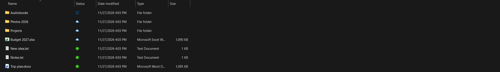

# Synclone

Multi-cloud sync client with native placeholder files for Windows and macOS, built on rclone.

Synclone puts one folder on your computer with a subfolder for each cloud storage you connect (Google Drive, OneDrive, Drime, and anything else rclone supports). Every file shows up without using disk space; open one and it downloads. Downloads stay until you remove them from the device. Changes you make upload automatically, and deleting a file locally never deletes it from the cloud until you empty Synclone's trash.

> **Status:** early development, not yet released. The sync engine, the command-line tool, the Windows integration (Explorer placeholders through the Cloud Files API) and the Windows tray app are built and tested; macOS comes next. See [`PLAN.md`](PLAN.md) for the full design and [`PROGRESS.md`](PROGRESS.md) for where things stand.



## Building from source

Requirements: Rust (stable), `bash`, `curl` and `unzip`.

```bash
scripts/fetch-rclone
```

```bash
cargo build --workspace
```

```bash
cargo test --workspace
```

`scripts/fetch-rclone` downloads the pinned rclone release from GitHub and checks its SHA-256 against `scripts/rclone-checksums.txt`.

## Command-line tool

`synclonectl` exposes every operation (connecting cloud storage, downloading, freeing space, the trash queue, conflicts). Run `synclonectl --help`. Paths are written as they appear in the Synclone folder: `"<cloud drive>/<path>"`.

```bash
synclonectl daemon
```

```bash
synclonectl drive add drive --name "Google Drive"
```

```bash
synclonectl download "Google Drive/Audiobooks"
```

```bash
synclonectl trash list
```

On Windows the Synclone folder (`%USERPROFILE%\Synclone`) is a native cloud folder in Explorer's navigation pane: cloud-only files show a cloud icon, "Always keep on this device" and "Free up space" work on files and folders, and opening a file downloads it with Explorer's own progress. On Linux the folders are plain directories, and files not yet downloaded appear as empty `*.sclstub` files (a test-only layout); macOS gets native placeholders in Phase 6.

## The app (Windows)

`Synclone.exe` (crate `synclone-app`) is the tray app: the menu from PLAN.md §6.1, the "Add cloud storage" wizard, and the Trash, Conflicts, Recent activity and Settings windows. It starts the background service itself (`Synclone --service`) and stops it on Quit.

```bash
cargo build -p synclone-app
```

The WebDriver tests for its windows need `tauri-driver` and `msedgedriver`; `scripts/webdriver-setup.ps1` puts both in `target/tools`, then run them with `SYNCLONE_WEBDRIVER=1 cargo test -p synclone-app --test webdriver`.

Synclone uses your existing rclone config file, so remotes you already have appear as cloud drives automatically.

## Credits

- **[rclone](https://rclone.org)** does all the talking to cloud providers. Synclone is built on rclone and is **not affiliated with the rclone project**. rclone is MIT-licensed; see [`THIRD-PARTY-NOTICES.md`](THIRD-PARTY-NOTICES.md).
- **[OpenCfDrive](https://github.com/dkgs2000/OpenCfDrive)** by dkgs2000 (MIT) showed how to drive `rclone rcd` safely and how to tell file versions apart across backends. Synclone adapts several of its designs; they are listed in [`DECISIONS.md`](DECISIONS.md) (D-006).
- Nimbus and Cascade were studied for design ideas only (no code used).

Synclone is not affiliated with odrive.

## License

Licensed under either of [Apache License, Version 2.0](LICENSE-APACHE) or [MIT license](LICENSE-MIT) at your option.
